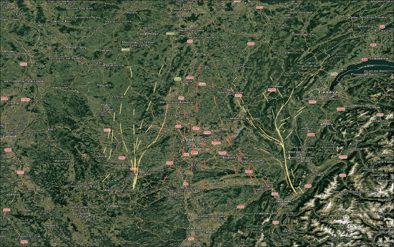
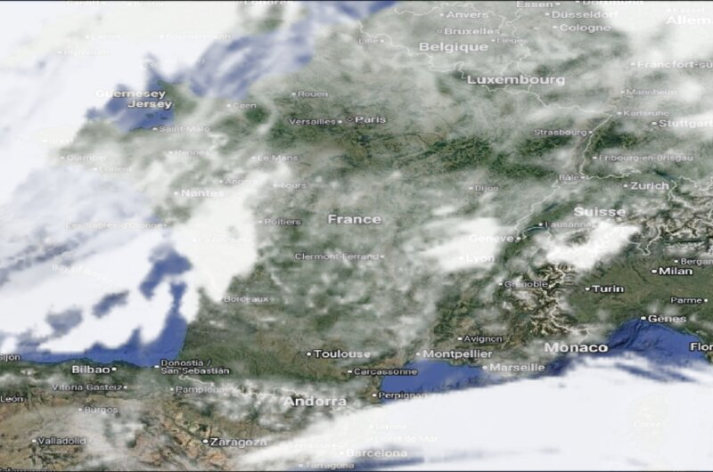

# wxforecast

Weather forecast maps from the public [dynamical.org](https://dynamical.org) Icechunk repositories, as
Cloud Optimized GeoTIFF, PMTiles, wind flow lines and GeoServer SLD. No account, reads only the chunks
covering your bbox. Plain library (no QGIS, no global state, thread safe) plus a QGIS plugin in
[`qgis/`](qgis/README.md).





## Supported data

Read from `https://stac.dynamical.org/catalog.json` at run time; `list_models()` is the authority.
Checked 2026-10-14; grids, read costs and quirks in [docs/data.md](docs/data.md).

| model id | grid | runs | leads |
|---|---|---|---|
| `noaa-gfs-forecast` | 0.25°, global | 6 h | 0-384 h: 1 h to 120 h, then 3 h |
| `ecmwf-aifs-single-forecast` | 0.25°, global | 6 h | 0-360 h, 6 h |
| `dwd-icon-eu-forecast-5-day` | 0.0625°, Europe | 6 h | 0-120 h: 1 h to 78 h, then 3 h |

Skipped: virtual collections, ensembles, projected grids (HRRR, HRDPS), analyses.

| variable | unit | GFS | AIFS | ICON-EU |
|---|---|---|---|---|
| `temperature_2m` | °C | ✓ | ✓ | ✓ |
| `temperature_80m` | °C | ✓ | - | - |
| `temperature_850hpa`, `_925hpa` | °C | - | ✓ | - |
| `maximum_temperature_2m`, `minimum_temperature_2m` (1) | °C | ✓ | - | - |
| `dew_point_temperature_2m` | °C | - | ✓ | ✓ |
| `relative_humidity_2m` | % | ✓ | - | ✓ |
| `precipitation_surface` (1) | kg m-2 s-1 | ✓ | ✓ | ✓ |
| `precipitable_water_atmosphere` | kg m-2 | ✓ | - | ✓ |
| `percent_frozen_precipitation_surface` | % | ✓ | - | - |
| `categorical_rain/snow/freezing_rain/ice_pellets_surface` | 0 or 1 | ✓ | - | - |
| `snow_thickness_surface`, `snow_water_equivalent_surface` | m | - | - | ✓ |
| `total_cloud_cover_atmosphere` (1) | % | ✓ | ✓ | ✓ |
| `cloud_cover_low`, `_medium`, `_high` | % | - | - | ✓ |
| `geopotential_height_cloud_ceiling` | m | ✓ | - | - |
| `pressure_reduced_to_mean_sea_level`, `pressure_surface` | Pa | ✓ | ✓ | ✓ |
| `pressure_80m` | Pa | ✓ | - | - |
| `geopotential_height_500hpa`, `_850hpa`, `_925hpa` | m | - | ✓ | - |
| `wind_10m` (2) | m s-1 | ✓ | ✓ | ✓ |
| `wind_80m` (2) | m s-1 | ✓ | - | - |
| `wind_100m` (2) | m s-1 | ✓ | ✓ | - |
| `wind_gust_10m` | m s-1 | - | - | ✓ |
| `downward_short_wave_radiation_flux_surface`, `downward_long_wave_...` | W m-2 | ✓ | ✓ | - |
| `downward_direct_short_wave_...`, `downward_diffuse_short_wave_...` | W m-2 | - | - | ✓ |
| `convective_available_potential_energy_atmosphere` | J kg-1 | - | - | ✓ |

(1) Averaged since the previous step: NaN at lead 0, so `fetch` raises there.
(2) Speed from `wind_u_<level>` and `wind_v_<level>`, plus `direction` in degrees the wind blows FROM
(westerly = 270). Components stay fetchable.

Units are as stored; legends only relabel Pa as hPa and kg m-2 s-1 as mm/h.

## Install

Python 3.12+, [uv](https://docs.astral.sh/uv/), system GDAL (`osgeo.gdal`, only for writing files).

```sh
uv venv --system-site-packages && uv sync
```

## Use

```python
from datetime import timedelta
import wxforecast

bbox = (-10.0, 35.0, 30.0, 60.0)  # west, south, east, north; west > east crosses 180
t2m = wxforecast.fetch("noaa-gfs-forecast", "temperature_2m", bbox=bbox, lead=timedelta(hours=24))
wxforecast.to_geotiff(t2m, "out/t2m.tif")              # COG, float32, NaN nodata, EPSG:4326
wxforecast.to_sld(t2m, "out/t2m.sld")                  # GeoServer ColorMap, same colours

wind = wxforecast.fetch("noaa-gfs-forecast", "wind_10m", bbox=bbox)
wxforecast.to_geotiff(wind, "out/wind.tif")            # band 1 speed, band 2 direction
wxforecast.to_flow_lines(wind, "out/flow.gpkg")        # streamlines: speed, phase
wxforecast.to_sld(wind, "out/flow.sld", flow=True)

areas = [wxforecast.bbox_wkt(bbox), *wxforecast.areas_from_vector("france.gpkg")]
wxforecast.to_pmtiles(t2m, "out/t2m.pmtiles", areas, clip=True)

steps = wxforecast.fetch_range("noaa-gfs-forecast", "temperature_2m", bbox=bbox,
                               days=2, every=timedelta(hours=6))
wxforecast.to_pmtiles_steps(steps, "out/t2m", areas)  # one archive per step + index.json
```

- `run=None` takes the latest run with data (a run still being written falls back to the previous one);
  `lead=None` takes the valid time nearest now. Pass an explicit `run` in DAGs so retries read the same data.
- Unknown model, variable, run or lead raises `ValueError` listing what exists.
- `fetch_range` reads the lead range in one slice: 9 steps cost about one.
- PMTiles: 256 px PNG, Web Mercator, `max_zoom` defaults to the model's native zoom + 2 (GFS: 5),
  limit zoom 12 and ~100 000 tiles (`estimate_tiles(areas, min_zoom, max_zoom)` checks before fetching),
  no bbox across 180. `progress(done, total)` returning False raises `Cancelled`, no file left. Wind
  tiles add arrows; directions are never interpolated (u and v are).
- Every output is written under a temp name and renamed: no partial files.

## Styles

One TOML table per kind in [`src/wxforecast/styles.toml`](src/wxforecast/styles.toml), shared by
PMTiles, SLD and QGIS. First kind whose `names` or `units` match wins, else `other`. Override with a file
passed as `styles=` or `WXFORECAST_STYLES`: it changes only what it names.

| key | value |
|---|---|
| `title`, `icon` | legend title; SVG in `qgis/wxforecast_qgis/icons/` (default `generic`) |
| `names`, `units` | case-insensitive globs on the variable name; exact units |
| `colors` | evenly spaced `#rrggbb` |
| `stops` | `[position 0..1, colour, alpha 0..255?, label?]`, ascending |
| `range` | `"data"` (default) or `[min, max]` |
| `anchor` | with `"data"`: `"zero"` or `"symmetric"` |
| `valid_min`, `valid_max` | outside = nodata |
| `discrete` | `true`: exact classes (0/1 flags) |

## GeoServer time dimension

One COG per step named with `step_name(step)` in one folder, published as an ImageMosaic (run GeoServer
with `-Duser.timezone=GMT`):

```properties
# indexer.properties
TimeAttribute=time
Schema=*the_geom:Polygon,location:String,time:java.util.Date
PropertyCollectors=TimestampFileNameExtractorSPI[timeregex](time)
# timeregex.properties
regex=[0-9]{8}T[0-9]{2},format=yyyyMMdd'T'HH
```

Flow lines of several steps carry a `valid_time` field for a vector time dimension.

## Tests

```sh
uv run pytest -m 'not network'   # offline
uv run pytest -m network         # live GFS over France
uv run ruff check . && uv run ruff format --check src tests qgis
```
